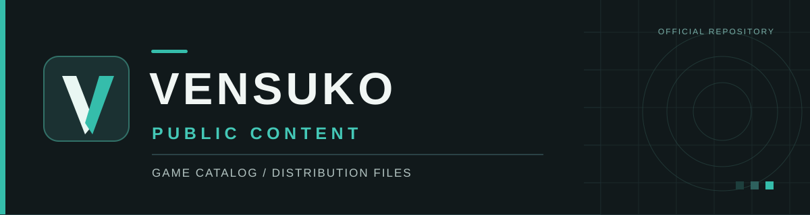

  

  <strong>The public game catalog and selected distribution files for the VENSUKO desktop launcher.</strong>

  <a href="https://github.com/ju53648/lumorix-launcher-releases/releases/latest"><strong>Get the launcher</strong></a>
  &nbsp;·&nbsp;
  <a href="https://github.com/ju53648/lumorix-launcher-releases/releases">All releases</a>
  &nbsp;·&nbsp;
  <a href="distribution/manifests/catalog.json">Game catalog</a>
  &nbsp;·&nbsp;
  <a href="https://lumorix.net">Website</a>

---

## Overview

This repository provides the **public catalog metadata** and **downloadable game content** used by VENSUKO Launcher. It is a distribution endpoint, not the application's source-code repository.

> [!IMPORTANT]
> **Looking for VENSUKO Launcher?** Download the Windows installer from the [official launcher releases](https://github.com/ju53648/lumorix-launcher-releases/releases/latest). This repository only contains game-catalog and content-delivery files.

## Repository contents

| Location | Purpose |
| :-- | :-- |
| [`distribution/manifests/catalog.json`](distribution/manifests/catalog.json) | Catalog entry point that lists individual game-manifest URLs. |
| [`distribution/manifests/games/lumorix-dropdash.json`](distribution/manifests/games/lumorix-dropdash.json) | Metadata for **VENSUKO DropDash**, including its version, artwork references, supported actions, and download information. |
| [`distribution/games/lumorix-dropdash/release/`](distribution/games/lumorix-dropdash/release/) | Published desktop game archive for DropDash. |

The catalog can also reference game manifests hosted in other repositories, including **PORTLORIA & CO.**

## How the catalog works

1. The launcher retrieves the [catalog manifest](distribution/manifests/catalog.json).
2. The catalog points to the manifests for the available games.
3. Each game manifest describes its content and, where applicable, the downloadable package.

The distribution files are intended to be consumed by the launcher. If you want to install or update the **launcher itself**, use the [separate releases repository](https://github.com/ju53648/lumorix-launcher-releases).

## Source code and repository scope

- **Public here:** catalog metadata, game manifests, and selected packaged game builds.
- **Not included:** the VENSUKO Launcher application source code, internal development files, or credentials.
- **Launcher installers and updater files:** published separately under [VENSUKO Launcher Releases](https://github.com/ju53648/lumorix-launcher-releases/releases).

The GitHub repository path retains the name `lumorix-launcher-content`; existing distribution URLs reference that path.

<strong>Deutsch — Kurzüberblick</strong>

Dieses öffentliche Repository stellt den **Spielekatalog und ausgewählte Spieldateien** für den **VENSUKO Launcher** bereit. Hier liegen unter anderem die Katalogdatei, das Manifest von VENSUKO DropDash und das zugehörige Spielarchiv.

**Den Launcher selbst findest du hier nicht.** Die aktuelle Windows-Version und die offiziellen Updates gibt es bei den [VENSUKO Launcher Releases](https://github.com/ju53648/lumorix-launcher-releases/releases/latest).

Der Quellcode des Launchers wird nicht in diesem öffentlichen Repository veröffentlicht.

---

  VENSUKO Launcher · Public content distribution

